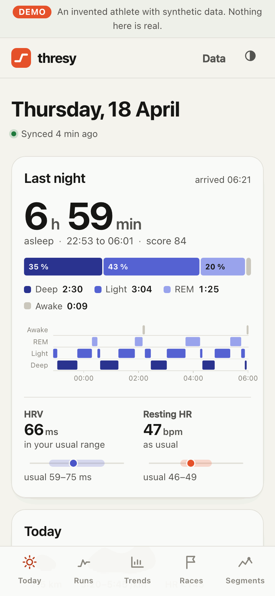
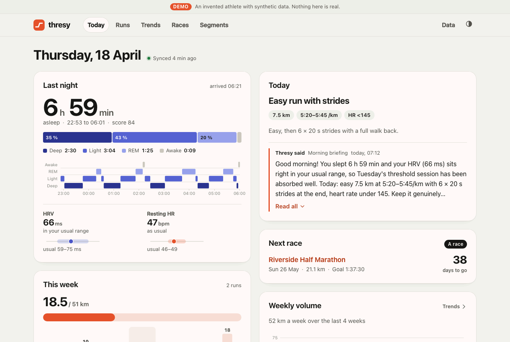

# Web dashboard

`coach web` serves a private dashboard for the athlete: last night, today's session and what
the coach said this morning, the week's plan next to what was run, recent runs with a page
for each, trends over weeks and years, races, segments and the state of the data. It is a
read-only window on the database, behind a login, made to be opened on a phone in the morning.

It is optional: without the Compose profile `web` the service does not run. It never writes
to the database, sends nothing to the chat and starts no agent run; chatting with the coach in
a browser would be a transport (`thresy.transport`), not part of the dashboard.

<p>
  
  
</p>

## Pages

| Page | Shows |
|---|---|
| Today (`/`) | Last night (duration, stages, the night's course, HRV against its usual range, resting heart rate), honest about a night that has not arrived yet; today's planned session; the coach's latest morning briefing or run debrief, shortened; this week's plan next to what was run, day by day, with the kilometres so far; the next race with a countdown; weekly volume of the last 12 weeks; the last five runs; notices when something needs attention |
| Runs (`/runs?year=`) | Every run of a year by month: date, name, distance, pace, heart rate, ascent |
| One run (`/runs/<id>`) | Distance, time, pace, heart rate, ascent, cadence; the planned session it fulfilled; the shape of the track; splits against the run's average pace; first and second half; heart-rate drift; pace, heart rate and altitude over the distance with a shared crosshair; reps of a structured session; climbs; segment efforts |
| Trends (`/trends`) | Weekly volume of half a year with the longest run of each week; the year to date against earlier years; HRV, resting heart rate and sleep over twelve weeks with their usual range and a 7-day average |
| Races (`/races`) | The next race with a countdown, distance, ascent and goal; other races to come; results |
| Segments (`/segments`) | Every stored segment with its best and latest effort and all efforts over time |
| Data (`/data`) | The last sync, the Garmin login, the last backup and restore check, how much the database holds, and the same notices as on Today |

Every number comes from the functions behind the `coach` commands: `thresy.analysis.night`,
`.wellness`, `.weeks`, `.activity` (splits, halves, drift, climbs), `.intervals`, `.segments`,
`thresy.tools.plan.week` and `thresy.tools.races.listing`. Where none exists the dashboard has
a few small read helpers in `thresy.web.source` (runs per year, distance per day for the year
chart, the latest briefing, the state of sync and backup). The overview reads summary tables
only, never per-second samples; a run's page reads that one run's samples and draws about 240
points from them. Pages are rendered on the server and work without JavaScript; a small script
adds the theme switch, tooltips and the crosshair.

Notices: the Garmin login needs renewing; the sync failed three times in a row or has not
succeeded for 12 hours; the last backup failed or the last good one is more than 8 days old;
Garmin asked the sync to slow down. Nights are keyed by wake date as everywhere
(docs/ARCHITECTURE.md): "last night" is the night that ended this morning, and when it has not
arrived the page says so and names the latest night instead of showing an older one.

Texts are in English or German (`COACH_LANGUAGE`; other languages get English), dates and
numbers formatted for the language. Light and dark follow the system; the switch in the header
overrides it in this browser.

## Setting it up

The dashboard runs from the same image as the other services. It needs a password, a session
secret and a reverse proxy that terminates TLS (Thresy publishes no port).

1. **A password.** Generate one and its hash:

   ```sh
   docker compose run --rm --no-deps web coach web password
   ```

   It prints a random password once (keep it in your password manager) and the line
   `COACH_WEB_PASSWORD_HASH=scrypt:...` for `.env`. To use a password of your own (at least
   12 characters): `docker compose run --rm --no-deps web coach web password --stdin` asks
   for it without showing it; piped in, it reads the first line.

2. **A session secret.** `openssl rand -hex 32`, as `COACH_WEB_SECRET` in `.env`.

3. **The profile and the proxy.** In `.env`:

   ```sh
   COMPOSE_PROFILES=web
   COMPOSE_FILE=compose.yml:compose.traefik.example.yml   # with Traefik; see below
   WEB_HOST=coach.example.org                             # your host name
   TRAEFIK_NETWORK=proxy                                  # the network Traefik watches
   COACH_WEB_CLIENT_IP_HEADER=X-Forwarded-For
   ```

   `COMPOSE_PROFILES` makes `docker compose up` include the `web` service; `COMPOSE_FILE` adds
   the override that attaches it to the proxy. Both are read by Compose from `.env`, so the
   usual commands need no `-f` or `--profile` options.

4. **Start it** and check:

   ```sh
   docker compose up -d web
   docker compose ps web                     # healthy
   docker compose logs web                   # "serving the dashboard on http://0.0.0.0:8080"
   ```

   Open `https://<WEB_HOST>/`: the login page. After signing in you stay signed in on that
   device for `COACH_WEB_SESSION_HOURS` (14 days by default).

Without a hash or a secret the service refuses to start and says which one is missing. To
change the password, create a new hash and restart: every session ends. To sign out every
device (a lost phone), change `COACH_WEB_SECRET` and restart.

### Settings

| Variable | Default | Meaning |
|---|---|---|
| `COACH_WEB_PASSWORD_HASH` | (required) | The password's scrypt hash from `coach web password`. Only the hash is configured, never the password. |
| `COACH_WEB_SECRET` | (required) | At least 32 characters; signs the session cookies and form tokens. Changing it ends every session. |
| `COACH_WEB_SESSION_HOURS` | `336` | How long a login lasts. |
| `COACH_WEB_CLIENT_IP_HEADER` | unset | The header in which the reverse proxy passes the client's address (below). |
| `COACH_WEB_CLIENT_IP_HOPS` | `1` | For a list-valued header: which entry, counted from the right. |
| `COACH_WEB_HOST` | `0.0.0.0` | Address to listen on (inside the container). |
| `COACH_WEB_PORT` | `8080` | Port to listen on. |
| `COACH_WEB_DEV_HTTP` | `false` | Development only: cookies without `Secure`, so the login works over plain HTTP; the server then listens on a loopback address only. |
| `WEB_MEM_LIMIT` | `256m` | The service's memory limit (Compose). |

From the core settings it uses `COACH_DATABASE_URL_RO` (the `coach_ro` role; Compose builds it
from `DB_RO_PASSWORD`), `COACH_TZ`, `COACH_LANGUAGE` and `COACH_NAME`. It gets nothing else:
no other database URL and no Garmin, Telegram, model, routing or backup credential.

## Security model

The dashboard shows health data and sits on the public internet, so it is built to fail
closed.

- **Everything needs a session.** A gate in front of the router lets through only the login
  page, `/healthz`, `/robots.txt`, the favicon and `/static/` (stylesheet, scripts, icon: no
  data). Every other path, including unknown ones, sends a browser to the login page and
  refuses anything else with 403, so a route added later is protected without doing anything.
  The tests list every route and fail on one they do not know.
- **One password, hashed.** scrypt (N = 2^15, r = 8, p = 1) with a random salt, stored as
  `scrypt:ln=15,r=8,p=1:<salt>:<hash>` (no `$`, so `.env` interpolation cannot mangle it);
  compared in constant time. The generated password has about 123 bits. Every failed login
  gets the same answer and takes at least a second, whether the password was wrong, empty or
  absurdly long.
- **Sessions are signed cookies.** `__Host-thresy_session`: `HttpOnly`, `Secure`,
  `SameSite=Lax`, path `/`, no domain; the value carries a random session id and the expiry,
  signed with HMAC-SHA256 under a key derived from `COACH_WEB_SECRET` and the password hash.
  Changing either ends every session. Logout deletes the cookie and remembers the session id
  as revoked until it would have expired.
- **Cross-site requests.** Only two requests change state, login and logout. Both are POST,
  need `Sec-Fetch-Site: same-origin` (or, from browsers without it, an `Origin` naming this
  host) and a signed form token: the login form's token is valid for two hours, the logout
  token is bound to the session. Forms are small URL-encoded bodies (4 KB at most).
- **Rate limit.** Failed logins are counted per client and overall, in memory. A client has 5
  free attempts; then it waits 30 s, and each further failure doubles the wait, up to an hour.
  Overall, after 30 failures within an hour every client waits, likewise doubling up to 15
  minutes, so rotating addresses or a forwarded header does not get around the limit. While
  locked out the password is not checked at all, and the answer is 429 with `Retry-After`.
  IPv6 clients are counted by their /64 network.
- **Headers on every response**, errors included: a content security policy without inline
  script or style and without other origins (`default-src 'none'; script-src 'self';
  style-src 'self'; img-src 'self'; form-action 'self'; frame-ancestors 'none'; base-uri
  'none'`, ...), `X-Frame-Options: DENY`, `X-Content-Type-Options: nosniff`,
  `Referrer-Policy: no-referrer`, `X-Robots-Tag: noindex, nofollow, noarchive`,
  `Cross-Origin-Opener-Policy` and `-Resource-Policy: same-origin`, a restrictive
  `Permissions-Policy`, `Strict-Transport-Security`, and `Cache-Control: no-store` on
  everything but the static files. `/robots.txt` disallows everything.
- **Nothing leaves.** The browser talks only to the service: no web fonts, CDNs, map tiles or
  analytics. A run's track is drawn as a shape without a map. Links in the coach's messages
  open without a referrer; images in them are not shown.
- **No leaks in errors.** Error pages are generic; tracebacks go to the log, redacted like
  every log line (`thresy.logs`; both secrets are registered with it). A stored error from the
  sync or the backup is redacted again before it is shown.
- **Least privilege.** The `coach_ro` role in read-only sessions with a statement timeout; no
  capabilities, `no-new-privileges`, a read-only root file system, the internal network only
  (plus the proxy's network through the override), a memory limit.

Limits, plainly:

- One password, no second factor and no accounts. Anyone with the password sees everything.
- Revocations and the rate limit live in memory: a restart forgets them. A stolen session
  cookie stays valid until it expires unless you change `COACH_WEB_SECRET`.
- The overall rate limit means an attacker can keep the athlete from signing in for up to 15
  minutes at a time while an attack lasts; an existing session is not affected.
- The per-client limit is only as good as the client address (next section). The overall limit
  does not depend on it.
- TLS is the proxy's job. With `COACH_WEB_DEV_HTTP` the cookie travels in clear text; use it on
  your own machine only.

## Behind a reverse proxy and a CDN

The service listens on port 8080 on its Compose network and publishes no host port; the
deployment's reverse proxy terminates TLS and forwards to it. `compose.traefik.example.yml` is
an override for Traefik that takes everything specific from `.env` (`WEB_HOST`,
`TRAEFIK_NETWORK`, `TRAEFIK_ENTRYPOINT`, `TRAEFIK_CERTRESOLVER`) and can be used as it is;
`compose.yml` itself holds nothing proxy-specific. For another proxy, write an override along
the same lines: put `web` on a network the proxy can reach and point the proxy at port 8080.
Check the merged configuration with `docker compose config`.

### Client addresses

Behind a proxy, every connection comes from the proxy. For the per-client rate limit the
service needs the client's address from a header, and it must take it only from a header that
the client cannot forge. Name it with `COACH_WEB_CLIENT_IP_HEADER`:

| Set-up | Setting |
|---|---|
| Traefik (or nginx, Caddy) facing the clients | `X-Forwarded-For`, hops `1`. The proxy appends the address it saw as the last entry; whatever a client puts in front of it is ignored. |
| A CDN in front of Traefik, and Traefik trusts the CDN's addresses (`forwardedHeaders.trustedIPs`) | `X-Forwarded-For`, hops `2`: the CDN appends the client, Traefik appends the CDN. |
| Cloudflare in front, and the origin accepts connections from Cloudflare only | `CF-Connecting-IP`. Only safe when nobody can reach the origin around Cloudflare: a request that bypasses it can set the header to anything. |
| Unsure | Leave it unset. Every request then counts as coming from the proxy: the per-client limit acts as a second overall limit, which is safe but stricter. |

A header that is missing, malformed or shorter than the hops expected falls back to the
connection's address. Whatever is configured, the overall limit still applies.

A CDN must not cache the dashboard: every page is sent with `Cache-Control: no-store`, and the
static files (public, no data) with a week's lifetime.

## The demo

`coach web demo` renders the dashboard of a synthetic athlete, without a database and without
real data: about two years of runs building towards a half marathon, nights with stages and
HRV, a plan, two races, two segments, a morning briefing and the state of the sync, all
invented and generated from a fixed seed, on a fixed date (Thursday, 18 April 2030). Every page
carries a "Demo" bar.

```sh
coach web demo --out site/                # every page as static files; open site/index.html
coach web demo --out demo.html --single-file   # the overview as one self-contained file (English)
coach web demo --scenario new             # an athlete who just started: the empty states
coach web demo --scenario trouble         # an expired Garmin login and failing backups
coach web run --demo                      # serve it on http://127.0.0.1:8080, no login
```

`--language de` renders it in German. The single file has its styles, script and icon inline
and makes no request at all. The tests load the demo athlete into a database and check that
every page rendered from the database equals the page rendered from the demo, which keeps the
demo honest and the database queries right.

## Development

```sh
uv run coach web run --demo --port 8765                    # the demo, no database
echo "a long local password" | uv run coach web password --stdin   # a hash for .env
COACH_WEB_DEV_HTTP=true uv run coach web run --port 8765   # the real thing, over plain HTTP
```

With `COACH_WEB_DEV_HTTP=true` the server listens on 127.0.0.1 only. Templates
(`src/thresy/web/templates/`), the stylesheet and the script (`static/`) are package data;
the image contains them because it installs the source tree.

How the charts are drawn (`thresy.web.charts`): inline SVG made on the server, with colours
from CSS classes so they follow the theme and need no inline styles. One accent colour
(vermilion) for effort and for "now", one data hue (indigo) for recovery, greys for context;
the sleep stages are one indigo ramp. Thin marks with rounded ends on a single baseline,
hairline grids, a 2 px gap between stacked parts, labels only where they help (the latest and
the largest value, line ends), round ticks (paces in whole minutes or 30 seconds), and a
`<title>` on every hover target that the script turns into a tooltip. Every chart that carries
many values has a table view. Each chart is drawn at its phone width and its desktop width,
and CSS shows the one that fits, so text in charts keeps its size.
